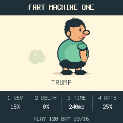

# Fart Machine One

Turns your M-VAVE FM-1 into a questionable musical instrument. Eleven artisanal
farts, reverb, delay, and a 16-step sequencer. Finally, a productive use for wind
instruments.



## Install: from download to first fart

You do **not** need to build the firmware. You will need:

- An **M-VAVE FM-1** and a USB cable that carries data.
- A computer with **Python 3** installed. If needed, get it from
  [python.org](https://www.python.org/downloads/).
- The two downloads listed below, from the same release.

This is replacement firmware for the FM-1. Installation replaces its current
firmware. Keep the USB cable connected until installation and restart finish.
The supplied package was installed on our FM-1 and its identity verified;
other computer setups and starting firmware versions have not all been tested.

### 1. Download the firmware and source

Open **Releases** on this repository's GitHub page and open the release you want.
Under **Assets**, download:

- **fart-machine-one.fwsc** — the ready-to-install firmware.
- **fart-machine-one-source.zip** — the source, samples and installation tool.

Extract the source ZIP. Find the folder containing `README.md`,
`requirements-install.txt` and the `tools` folder. Copy `fart-machine-one.fwsc`
into that same folder. Leave the firmware file as `.fwsc`; do not unzip it.

### 2. Open a terminal in that folder

**macOS:** Open Terminal, type `cd ` (including the space), drag the extracted
folder from Finder into Terminal, then press Return.

**Windows:** Open the extracted folder in File Explorer, click its address bar,
type `cmd`, then press Enter. The Windows commands below are for Command Prompt.

**Linux:** Open a terminal in the extracted folder using your file manager, or
use `cd` to move into it.

### 3. Set up the installer

Run these lines one at a time.

**macOS / Linux:**

```sh
python3 -m venv .venv
. .venv/bin/activate
python -m pip install -r requirements-install.txt
```

**Windows (Command Prompt):**

```bat
py -m venv .venv
.venv\Scripts\activate
python -m pip install -r requirements-install.txt
```

Keep this terminal window open for the remaining steps.

### 4. Connect and check your FM-1

Connect the FM-1 by USB. Close your DAW, MIDI utilities and browser tabs that
might be using its MIDI connection. Then run:

```sh
python tools/fm1_install.py --info
```

The installer should report the FM-1's identity and MIDI port. This command
only checks the connection; it does not install anything.

### 5. Install

```sh
python tools/fm1_install.py fart-machine-one.fwsc
```

Read the confirmation prompt, check that it is the intended device, and type
`y` to continue. Wait for the update and restart to finish. Successful completion
reports that the FM-1 runs **FM-1_701**. You can run the `--info` command again
to check.

### 6. Make something regrettable

Start with the volume low and press a key. Tap **REC**, play a few sounds, then
tap **REC** again to hear the loop without adding notes. Turn the four effect
knobs to add reverb and delay. Press **PLAY** to stop, or hold **REC** for one
second to clear the loop.

**Your loop stays in memory only. Turning the FM-1 off clears it.**

### If something goes wrong

| Problem | What to try |
| --- | --- |
| Python command not found | Install Python 3, reopen the terminal and return to the source folder. On Windows, use the `py` command shown above. |
| `requirements-install.txt` or the installer cannot be found | Check that your terminal is in the folder containing this README and `tools`. |
| Firmware file cannot be found | Put `fart-machine-one.fwsc` beside this README and check its filename. |
| No FM-1 found | Try a USB data cable and close other apps using MIDI. The error lists the MIDI input names it can see. |
| Multiple MIDI devices | Add `--port "part of the FM-1 port name"` to the command, using the actual name reported on your computer. |
| Interrupted update; FM-1 still in update mode | Run the same install command again to finish the update. |
| Dependency installation fails | Keep the error text and include your operating system and Python version when asking for help. |

The [short installation guide](INSTALL.md) has the compact command sequence.
For developers, [BUILDING.md](BUILDING.md) explains building from source.

## Controls

| Control | Behavior |
| --- | --- |
| All 27 keys | Play a full one-shot sample immediately, whether stopped, playing or recording. Eleven sounds repeat across the keys. |
| PLAY | Start the loop from step 1, or stop playback and recording, silence all voices/effect tails and clear puffs. Stopping retains the loop. |
| REC — tap and release | Start recording from step 1 if stopped. During playback, turn overdubbing on/off without restarting. Turning recording off leaves playback running. |
| REC — hold 1 second | Clear the whole loop, stop and silence everything. Releasing after a clear does not start recording. Tempo/effects stay unchanged. |
| SELECT | Tempo, 40–240 BPM, one BPM per detent; starts at 120. |
| KNOB 1 | Reverb amount. |
| KNOB 2 | Delay amount. |
| KNOB 3 | Delay time, 80–500 ms. |
| KNOB 4 | Delay repeats/feedback, 0–70%. |
| MASTER | Volume. |

One bar of 16 sixteenth-notes. Recording snaps to the nearest step. Different
sounds can share a step; recording the same sound again on the same step updates
its velocity rather than duplicating it. Repeated keyboard copies of one sample
share that stored sound. A live tap is heard immediately; a tap quantized ahead
joins loop playback on the next circuit, avoiding a second near-immediate echo.
Eight audio voices are available, with oldest-voice replacement if more overlap.

The bottom line shows STOP / PLAY / REC, tempo and the current step while running.
The four effect values remain visible while the cartoon and status strip animate. PLAY lights when running, REC
lights when recording, and PLAY uses its red LED during recording.

**The one pattern lives in RAM. Power-off/reboot clears it.** No song mode,
multi-pattern storage, lane editing or synth engines. Musical controls not listed
above are unused. Hardware calibration, boot recovery and update shortcuts remain.

MIDI channel 1 notes 53–79 play/record the corresponding keys with velocity;
note-off does not shorten the sample. CC120/123 stop transport and silence sound
without erasing the loop. MIDI clock sync is not implemented.

## Sounds and names

In original numeric filename order (1–7 and 9–12): TOOT, TRUMP, PFFT, RASPBERRY,
WIND, FLATULENCE, BOTTOM BURP, AIR BISCUIT, RIPPER, SBD, LET RIP. The same name
appears wherever a sample repeats over 27 keys, with no numbered suffixes.

The eleven recordings total 6.312585 seconds and are mono PCM16 at 44.1 kHz.
Copies and checksums are under `samples/`. The compiled bank is 278,384 bytes of
mono 22,050 Hz PCM. The sounds are reported to originate from Pixabay and have
separate audio terms; the code licence does not cover them. See
[samples/ATTRIBUTION.md](samples/ATTRIBUTION.md).

To reproduce the bank without altering source WAVs:

```sh
python3 tools/import_samples.py samples/originals --names samples/display_names.json
```

Importer accepts 1–27 PCM16 mono/stereo WAVs at 8–192 kHz, converts to 22,050 Hz
mono, removes DC, limits excessive peaks and applies brief boundary fades.
Compiled audio budget: 320 KiB, about 7.4 seconds of unique audio; no automatic
truncation. `--map mapping.json` optionally specifies 27 source basenames;
`--names names.json` supplies distinct readable display labels up to 20 ASCII
characters. Names affect metadata only. Tests use a separate generated fixture.

## Build, test, preview and provenance

See BUILDING.md. `tests/run_tests.sh` includes sanitized playback/FX/UI/sequencer
checks and platform tests. Additional actual-bank timing/stress/browser tests and
screenshots are under `tests/fmo/`; generated results go under `build/`.

This GPL-3.0-only fork is based on FoMni commit
`405ef41aef75f7e70afd6decc01505df07c708e9`, with the Felucca-derived HAL, USB,
audio, flash/loader and recovery support retained. Original cartoon/puff geometry
was drawn from scratch in `firmware/src/app/cartoon.h`; no downloaded/copied
character sprites or existing character reference were used. Inherited code and
the licensed Terminus font remain credited separately. See LICENSING.md and
`docs/ARTWORK-PROVENANCE.md`.

Package identity: **FM-1_701**. See [BUILDING.md](BUILDING.md) for the source build
and [LICENSING.md](LICENSING.md) for code, audio and third-party notices.
Native/browser CPU figures are not an FM-1 timing measurement.


## Inspiration

Fart Machine One was partly inspired by [Tooty Loop](https://cannice.itch.io/tooty-loop), a game-jam project I worked on with my friend Candace (cannice) for the GMTK Game Jam 2025. Candace led the idea and game development, and I contributed the sound work. Big thanks to her for the original spark—go give Tooty Loop a toot!
